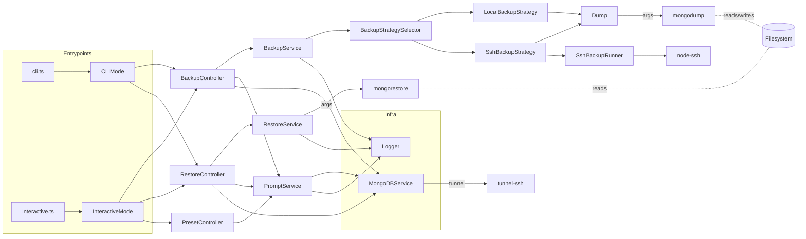

# ANALYSIS: Architecture, Issues, and Recommendations

This document synthesizes the architecture overview, key issues/limitations, and a prioritized improvement plan (including test strategy) for the MongoDB Collection Cherry Picker CLI.

It is intended for maintainers, reviewers, and stakeholders to align on current design, risks, and next steps.

## 1) Architecture Overview

High-level purpose: a Node.js/TypeScript CLI that creates selective MongoDB backups and restores them, supporting interactive prompts and non-interactive (scriptable) usage, plus SSH-backed operations.

Layers and modules (src/):
- entrypoint/
  - cli.ts → non-interactive orchestration via CLIMode
  - interactive.ts → interactive orchestration via InteractiveMode
  - modes/cli-mode.ts and modes/interactive-mode.ts → wire controllers/services
- modules/
  - backup/ → BackupController, BackupService, strategies (local/ssh), Dump domain for mongodump arg building
  - restore/ → RestoreController, RestoreService for mongorestore orchestration
  - prompt/ → PromptService, PresetController using Inquirer and UpdateableConfig
- config/
  - config.ts (load/validate with Zod), updateable-config.ts (persist changes), zod-schemas/
- infrastructure/
  - logger.ts (spinner-aware structured console logger)
  - mongodb.service.ts (direct or SSH-tunneled MongoDB connections using mongodb driver + tunnel-ssh)
- utils/ → helpers (parse-mongo-uri, object-id-from-timestamp, formatted timestamp, format-filename)
- types/ → AppConfig, ConnectionConfig, BackupPreset, BackupMetadata
- test/e2e/ → Jest + Testcontainers end-to-end tests

Key third-party/external tools:
- mongodump and mongorestore (executed via child_process spawn or over SSH)
- node-ssh for streaming remote commands (SSH backup)
- tunnel-ssh for MongoDB driver tunnel connections (metadata and collection discovery)
- Inquirer for interactive UX
- Zod for config validation
- Testcontainers (current E2E); mongodb-memory-server recommended for unit/integration (see roadmap)

### Component roles and relationships
- CLIMode/InteractiveMode
  - Parse args (CLIMode), or drive inquirer flows (InteractiveMode)
  - Instantiate controllers/services and dispatch operations

- BackupController
  - Interactive backup: prompt for connection, selection mode, collections, optional time filter
  - Preset backup: resolve preset and run
  - Arg-based backup: validate/normalize effective selection
  - Generates and writes BackupMetadata .json sidecar

- RestoreController
  - Interactive restore or arg-based restore to target
  - Loads metadata, validates file, invokes RestoreService, outputs summary

- BackupService
  - Selects strategy (LocalBackupStrategy vs SshBackupStrategy)
  - Returns final archive path
  - Can load metadata and list backup files

- LocalBackupStrategy
  - Build mongodump args (via Dump) and spawn local process

- SshBackupStrategy + SshBackupRunner
  - Build args (Dump), stream remote mongodump over SSH into a local temp file, then rename

- RestoreService
  - Build mongorestore args; supports namespace mapping and drop; executes locally
  - SSH restore not implemented (explicitly warns)

- MongoDBService
  - Connects directly or via SSH tunnel (tunnel-ssh) for collection discovery, etc.
  - Helper to build Mongo URIs either from URI or host/port/auth pieces

- Logger
  - Spinner-aware logging, info/warn/error/debug, snippets

### End-to-end flows
- Backup (interactive)
  1) User selects source, mode, collections in PromptService
  2) BackupController derives effective include/exclude set (using MongoDBService to list collections when needed)
  3) BackupService selects strategy; Dump builds mongodump args
  4) Local spawn or SSH streaming produces .gz archive
  5) BackupController writes metadata JSON

- Backup (CLI)
  1) CLIMode parses args, validates combinations (e.g., since-time requires include + one collection)
  2) BackupController.backupFromArgs runs same service path and writes metadata

- Restore (interactive/CLI)
  1) RestoreController loads metadata, validates archive exists
  2) RestoreService composes mongorestore invocation, maps namespaces if needed, and executes locally
  3) Output parsed for summary

- SSH backup
  - NodeSSH executes mongodump remotely with properly quoted args; data is streamed to a local temp file and renamed on success

## 2) Architecture Diagram

Mermaid (if supported):

If Mermaid is unavailable, the textual flow is: Entrypoints → Modes → Controllers → Services/Strategies → External tools (mongodump/mongorestore) and Infrastructure (MongoDBService via tunnel-ssh; NodeSSH for remote exec) with Logger across all layers.

## 3) Key Issues and Limitations (prioritized)

High priority
- SSH restore not implemented
  - RestoreService explicitly warns and returns; no SSH path exists for mongorestore
- mongodumpPath config ignored for local/ssh backup
  - LocalBackupStrategy spawns hardcoded 'mongodump' and SshBackupStrategy assumes same
  - AppConfigSchema exposes mongodumpPath, but Backup uses none of it
- Config schema incompleteness vs code usage
  - Zod ConnectionConfigSchema omits fields used elsewhere: hosts, replicaSet, options, authSource/authDatabase variants
  - Zod defaults strip unknown keys, likely removing these values from parsed config
- Potential secret leakage in logs
  - LocalBackupStrategy logs full mongodump command with --password and possibly --uri containing credentials
  - SshBackupRunner logs reconstructed remote command too
- Fragile quoting/arg passing
  - For local spawn (shell=false) some args (e.g., --uri="...") contain quotes; safer to pass as ['--uri', value]
  - SSH command string requires careful quoting; current heuristics are complex and still risky
- Logger.extendPrefix mutates instance state
  - BackupStrategySelector calls logger.extendPrefix(...) and passes the same instance; stateful mutation can produce hard-to-reason prefixes across components

Medium priority
- Time-filter backups limited to include + exactly one collection and assumes _id is ObjectId
  - Not applicable to non-ObjectId _id schemas or compound primary keys; no createdAt-based filter alternative
- Overuse of --forceTableScan when no query
  - Can be heavy on large collections; can cause performance impact on primaries
- Weak error propagation/detail
  - Some catch/rethrow patterns drop original error context (e.g., new Error('failed') without cause)
- No child-process timeouts or signal handling
  - mongodump/mongorestore can hang; SIGINT/SIGTERM not gracefully closing children or tunnels
- Preflight for external tools missing
  - No check that configured mongodump/mongorestore paths exist or are executable
- SSH resiliency limited
  - No keepalive tuning, retry/backoff, or structured SSH failures; host key handling not documented

Low priority
- CLI arg parsing is manual
  - Yargs/commander would reduce edge cases and produce better help/usage
- Observability
  - Logger is helpful, but lacks structured logs and redaction utilities; debug on/off is coarse
- Test breadth
  - Nice E2E baseline with Testcontainers; lacks unit tests for arg-builders, quoting, and error paths; no SSH E2E yet

## 4) Recommendations and Action Plan

Short-term (high impact, low risk)
1) Respect mongodumpPath consistently
   - LocalBackupStrategy: spawn(config.mongodumpPath || 'mongodump', ...)
   - SshBackupStrategy log/build remote command using config.mongodumpPath
2) Fix local arg passing and redact secrets
   - Always push args without embedded quotes: e.g., baseArgs.push('--uri', source.uri)
   - Before logging, scrub credentials: mask passwords and redact URI userinfo
3) Expand Zod ConnectionConfigSchema
   - Include: hosts[], replicaSet, options (Record<string,string|number|boolean>), authSource/authDatabase/authenticationDatabase variants
   - Consider schema .passthrough() to avoid dropping unknown keys during transition
4) Implement preflight checks
   - On startup, verify mongodumpPath/mongorestorePath via which/exists; informative error if not found

Medium-term
5) Implement SSH restore
   - Approach A (streaming): ssh.exec("mongorestore --archive --gzip ...") and pipe local file to stdin
   - Approach B (remote file): scp archive to remote temp, then run mongorestore with --archive
   - Ensure arg quoting mirrors SshBackupRunner logic; add tests
6) Harden SSH
   - Add keepaliveInterval, readyTimeout, retries with backoff; surface clear error reasons
   - Optional host key policy config (knownHosts), jump host support
7) Better process lifecycle controls
   - Add timeouts; propagate SIGINT/SIGTERM to children; ensure tunnel and SSH disposed
   - Retry policies where safe (e.g., transient network issues)
8) Performance tuning flags
   - Add config for readPreference (e.g., secondaryPreferred), numParallelCollections, and writeConcern for restore
   - Allow disabling --forceTableScan; or scope to large-collection heuristics
9) Time filter flexibility
   - Optional createdAt/updatedAt filters using --query (collection-configurable field)
   - Support custom JSON query (sanitized) in preset/CLI
10) Logger ergonomics
   - Provide cloneWithPrefix(prefix) instead of mutating extendPrefix; dedupe prefixes
   - Introduce redact(text) helper and structured JSON logs (optional)

Longer-term / nice-to-have
11) Robust CLI UX using yargs/commander
   - Typed command definitions, help/usage, subcommands (backup/restore/preset)
12) Security and secrets
   - Centralized redaction; avoid logging raw command lines; prefer environment variables for credentials
   - Optionally allow external credential providers (env, vault)
13) Metadata richness
   - Record tool versions (mongodump --version, mongorestore --version), command-line used (sanitized), host info, SSH mode
14) Packaging and DX
   - Provide single binary via pkg or npx runner; add examples for CI usage

## 5) Testing Roadmap

Goals
- Validate arg construction, secret redaction, and corner cases without requiring Docker for every test
- Keep E2E for full-path verification (mongodump/mongorestore present), add targeted fast tests

Layers and proposed coverage
- Unit tests
  - utils: parse-mongo-uri (valid/invalid URIs), object-id-from-timestamp
  - Dump.buildArgs: matrices of configs (uri vs host/port, ssh vs local, include/exclude/all, with/without query)
  - Logger redaction: ensure passwords and URI userinfo are masked in logs
- Integration tests (fast)
  - mongodb-memory-server to spin ephemeral mongod for collection listing (MongoDBService.getCollections)
  - Mock child_process spawn to simulate mongodump/mongorestore success/failure, timeouts, stderr noise
  - Mock node-ssh to verify quoting and streaming logic
- E2E tests (existing baseline via Testcontainers)
  - Current: backup+restore all, preset include users only, negative preset case
  - Add: exclude mode, time filter include of a single collection, config using hosts[] and replicaSet, SSH backup to a disposable SSH container
  - Future: SSH restore once implemented

Tooling
- Jest with ts-jest
- mongodb-memory-server for integration speed
- Testcontainers reserved for full path incl. binaries
- CI matrix: Node LTS + MongoDB versions (e.g., 4.4, 5, 6)

## 6) Risk register and mitigations
- Secret exposure via logs → apply redaction, limit command echoing, add DEBUG gate
- Hanging processes and partial files → add timeouts; use .tmp and atomic rename (already used in SSH backup), cleanup on failure (already exists locally)
- SSH fragility → add keepalive and retry; clearer error reporting
- Schema drift between Zod and runtime types → unify schema with types and code; add schema tests

## 7) Concrete next steps (suggested order)
1) Redaction + arg passing fix + mongodumpPath usage (small PR)
2) Zod schema expansion and passthrough, add schema unit tests
3) Preflight checks for mongodump/mongorestore
4) Process timeouts and signal propagation to children; improve error wrapping with causes
5) SSH restore MVP (local archive piped to remote mongorestore); add tests
6) CLI hardening and performance flags surfaced via config
7) Add mongodb-memory-server integration tests; expand E2E matrix

## Appendix: Notable implementation details observed
- Backup metadata is saved next to .gz archive with consistent fields and ISO dates
- SSH backup writes to local .tmp then renames on success (durability)
- Restore currently parses stdout/stderr messages to compute a summary; robust to variations
- Tests already use Testcontainers for a simple end-to-end verification pipeline

— End of analysis —
